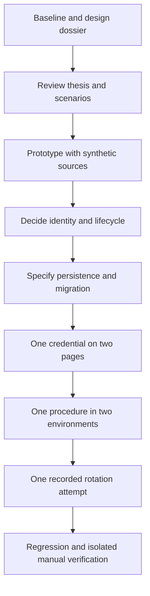

# Operational notebook: implementation preparation plan

## Status and tracking

Design-change preparation authorized on 2026-11-14. Detailed behavior and
architecture remain proposed until their own decisions are accepted.
Execution tracking: [epic #358](https://github.com/onetimesecret/macos/issues/358).

The [design dossier](../spec/design/operational-notebook/README.md) owns the
thesis, model, and scenarios. The [transition register](../spec/design/operational-notebook/transition.md#decision-register)
owns ON-D01–ON-D08. This plan describes sequence, not new product contracts.

## Baseline and working practice

- Annotated baseline: `baseline/pre-operational-notebook-2026-11-14` at
  `832fc8505bbf80d51c9794deaf7972c13e81195b`.
- Preparation marketing version: `0.50.0`; not a release or completed redesign.
- Existing repository and mainline, with short-lived implementation branches
  when authorized; no fork, rewrite, or permanent pivot branch.
- No real credential import, production-state conversion, or provider mutation
  during concept validation.

## Sequence

### P0 — Establish the design boundary

Outputs: baseline tag, `0.50.0` marketing version, dossier, dated snapshot,
navigation updates, and epic. Review the full direction without treating every
proposed model element as approved. Preparation does not complete later stages.

### P1 — Test context and provenance before building storage

Use ON-S01, ON-S02, and ON-S05 from the
[scenario catalogue](../spec/design/operational-notebook/scenarios.md).
Create a static or simulated interaction prototype under `docs/mockups/` only
when implementing this stage. No native app launch is needed to evaluate layout.

Compare the same synthetic task in two representations: separate credential
items plus instructions, and the proposed working page. Observe whether the
person identifies the environment, credential purpose, authoritative source,
imported-copy status, and unavailable source without prompting. Record retrieval
steps, wrong-target choices, and explanations in their own words. Do not invent
numerical improvement targets before observing a baseline.

Exit: recorded observations and an explicit decision to proceed, revise, or stop.
A prototype passes this gate only when the maintainer accepts the observed
interaction; attractive screenshots alone are insufficient.

### P2 — Resolve the first functional slice's contracts

Decide ON-D01 and ON-D02. Investigate ON-D07 against existing serialization,
identity, ownership, expiry, and sync code; identify exact implementation files
and tests in the resulting work issues rather than guessing them here.

Specify any changes to accepted laws/ADRs with exact replacement scope. Decide
whether legacy objects remain page-local until explicit reuse. Do not infer
identity from matching labels or plaintext. Define interruption, recovery,
downgrade, mixed-version, and concurrent-edit expectations before persistence
changes. If copy/export can encounter the slice, decide the relevant ON-D06
behavior before enabling it.

Exit: accepted contracts and synthetic fixture-based test cases for the enabled
paths. No storage rewrite is authorized solely by this plan.

### P3 — One credential, two pages

Implement the smallest accepted shared-reference behavior for an individual
operator, using a locally managed synthetic value. Show distinct local prose and
one inspectable credential identity. Make explicit reuse distinguishable from
clone. Test removal, expiry, unavailable values, and copy according to P2's
accepted policy; do not postpone those lifecycle cases until after release.

If this slice includes replacement of the current value, decide the applicable
ON-D04 version policy first. Otherwise omit replacement from the slice.

Exit: ON-S02 plus enabled portions of ON-S06/07 have automated results and an
isolated manual verification record. No claim of provider synchronization.

### P4 — One procedure, two environments

Decide ON-D05 and prototype ON-S03. Keep the chosen context and resolved
credential identity inspectable, including a missing-binding fixture. Determine
whether a dedicated template interface improves this task before committing to
one. This stage can be revised or deferred independently of shared references.

Exit: the user can distinguish the two environments and explain a missing
binding; no automatic substitution from the other environment.

### P5 — One recorded rotation attempt

Decide ON-D04. Test ON-S04 with two declared consumers, one using the candidate
and the other unresolved. Record provider revocation separately. Do not treat
notebook promotion as deployment, local deletion as revocation, or a previous
value as necessarily usable for rollback. Providers without overlapping
credentials require a different procedure, not a fabricated universal sequence.

Exit: partial adoption and unknown revocation remain intelligible without
command execution or live provider integration.

### P6 — Expand only from evidence

Select a real source connector only after ON-D03 and an observed need. A manual
locator remains useful without a connector. Shared workspaces require ON-D08 and
are outside the initial track; output adapters, command execution, and automatic
rotation are separate proposals.

## Validation and isolation

The project instruction in [AGENTS.md](../../AGENTS.md#runtime-testing) states:

> Automated UI tests and probes use both an injected temporary state directory and an in-memory credential client. Use `PageModel.Seams(stateDirectory:client:)` with the test-util ephemeral client; changing a bundle identifier alone is insufficient isolation.

It also states:

> Do not launch, replace, quit, or reset a person's running app to validate a change. Do not modify production identity constants to run a probe. A Keychain access prompt during automated testing is a reason to stop and audit the test setup, rather than authorize the prompt and continue.

Use synthetic data throughout this plan. Record automated checks and manual
sessions separately, following [contributor validation guidance](../../CONTRIBUTING.md).
The baseline tag and the version edit do not establish a passing build.

## Completion records

For each work item record four separate states: proposed behavior, explicit
acceptance, implementation reference, and verification evidence. Child issues
are created when their scope is actionable; do not pre-create a speculative
architecture backlog. The epic remains open until the accepted initial scope
has evidence, not merely because all preparation documents exist.
