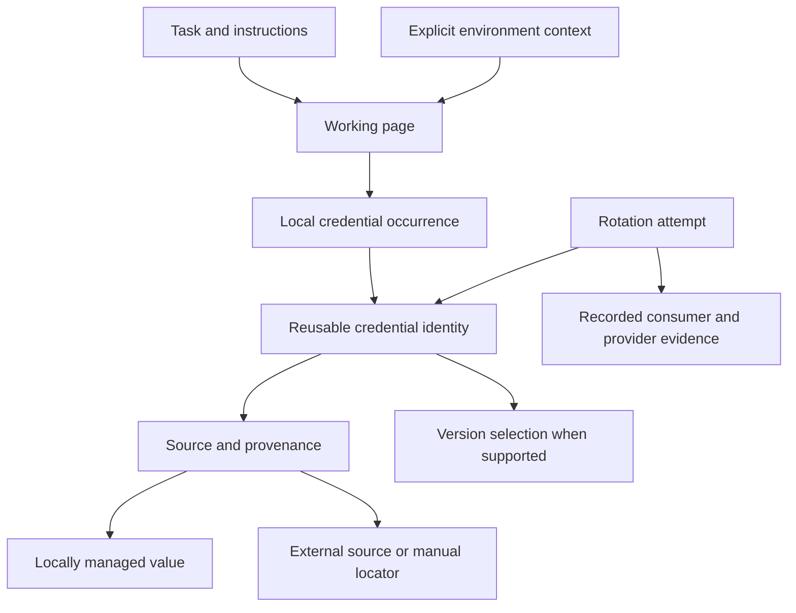

# OnetimePad — Design Spec for Operational Notebook

An open-source, Rust-based macOS desktop companion to Onetime Secret.
Working title: **OnetimePad**. This design retains that name; no rename is proposed.

## Status and scope of approval

Full product design change; design preparation authorized on 2026-11-14.
Detailed behaviors below are proposals, not shipped capabilities or accepted
architectural decisions. This is not an optional feature layered onto the old
product thesis.

The maintainer's direction in the design conversation is:

> Great job. I agree with your recommendations, with one change: it's a full design change, not just a feature so use this path that I got started for you: docs/spec/design/operational-notebook.

> Use the current HEAD of main for the tagging etc, and then bump the application version to v0.50.0, and continue

That direction authorizes the baseline, version bump, design dossier, prototype
plan, and execution tracking. It does not settle the open ownership, lifetime,
source, migration, or authorization questions. Existing accepted laws and ADRs
remain applicable until explicitly amended or superseded within their scope.

## Product thesis

**OnetimePad brings instructions and the credentials needed to follow them into
one working context, without requiring duplicate secret storage or a single
credential provider.**

This is the working thesis for design validation, not a statement that the
application already implements those capabilities. A short description is
*a notebook for work that requires secrets*.

### The problem

Credential storage and operational work have different useful structures:

- Storage is organized around vendors, accounts, credentials, and sources.
- Work is organized around environments, tasks, dependencies, and sequences.

A production investigation may require a sudo password, a Twilio credential,
and a GitHub token. Separate items require repeated retrieval. Collecting copies
in a workflow note creates another set of values to maintain. Rotation adds a
second coordination problem: updating providers and consumers while keeping
instructions and value references understandable.

The proposed principle is **normalize the secret; contextualize its use**.
Instructions supply local meaning. References reuse an independently identified
credential. Environment bindings can later reuse the procedure itself.

## Intended experience

A person starts by writing a page, not configuring a registry. They place a
credential or an external locator beside the step that needs it. When another
page needs that credential, an explicit reuse action references the same identity.
Repeated procedures can introduce roles and environment bindings progressively.

```text
Production EU · Investigate missing SMS

1. Inspect the delivery queue.
   Console login: Open external password-manager item

2. Inspect the worker.
   Sudo password: [ Production EU · sudo ]

3. Inspect the messaging configuration.
   Twilio credential: [ Production EU · messaging ]

4. Compare the deployed revision.
   GitHub credential: [ Messaging · deployment read access ]

Related: Rotate messaging credentials
```

This example is a design sketch. Brackets represent proposed references, not
interpolation syntax or independently copied values. Source availability and the
selected environment remain visible; an unavailable source does not make the
instructions disappear.

## Initial design scope

- Individual operators performing occasional, consequential tasks: diagnosis,
  deployment recovery, integration setup, and credential rotation.
- Instructions with local credential occurrences and explicit reuse.
- Source provenance distinguishing local values, imported copies, connected
  sources, and manual locators; connectors can be simulated initially.
- Explicit environment context and missing-binding states.
- A view of documented references, not automatic infrastructure discovery.
- Recorded rotation attempts with current/candidate distinctions and separate
  consumer observations and provider-revocation evidence.

Team workflows are relevant examples; shared workspaces and team authorization
are not prerequisites for the first prototype.

### Outside the initial scope

Command execution, arbitrary scripting, automatic provider-side rotation,
browser autofill, password-manager replacement, infrastructure discovery,
shared-workspace access control, and general workflow orchestration. Temporary
reveal is not proposed; the existing rule is quoted in the
[transition record](transition.md#existing-contracts-and-design-questions).

Document format, persistent occurrence IDs, connector selection, version
retention, and template UI are not selected by this dossier. No market-novelty
conclusion is established by the comparison with adjacent products.

## Design map



This is a conceptual map, not a storage schema or a completed architecture.
See the [conceptual model](conceptual-model.md) for identity, source, version,
retrieval state, and the separate rotation diagram.

## Validation question

Can a person return to an infrequent, sensitive task and understand which
credentials apply, where they come from, and what must change together,
without reconstructing that context from memory?

The [scenarios](scenarios.md) make this question observable. Validation compares
ordinary separate-item retrieval with the proposed working page and includes
missing bindings, unavailable sources, and partial rotation. No evaluation has
been performed by preparing these documents.

## Reading and execution order

1. [Conceptual model](conceptual-model.md): proposed vocabulary and relationships.
2. [Scenarios](scenarios.md): observable acceptance targets and failure cases.
3. [Transition](transition.md): baseline, accepted-contract excerpts, and decisions
   required before implementation.
4. [Implementation preparation plan](../../../plans/operational-notebook.md):
   staged validation and decision gates, with execution tracking.
5. [Dated baseline snapshot](../../../soto/2026-11-14-state-of-the-onion.md):
   what the demarcation records and what was not validated.

Keep proposal, acceptance, implementation, and verification separate. Approval
of the design track does not convert every model detail into an accepted rule.
