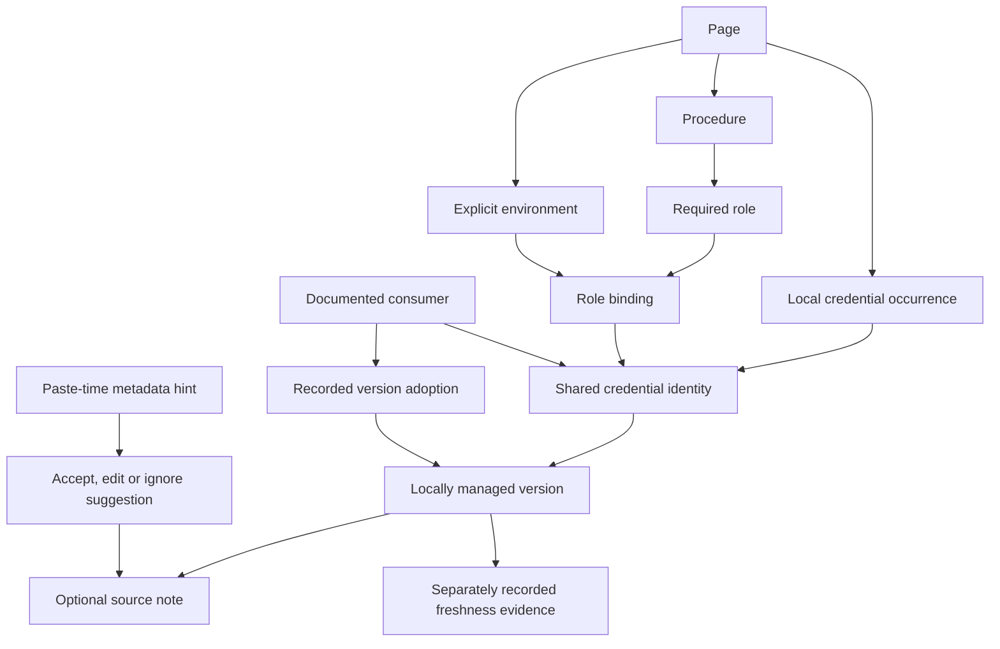
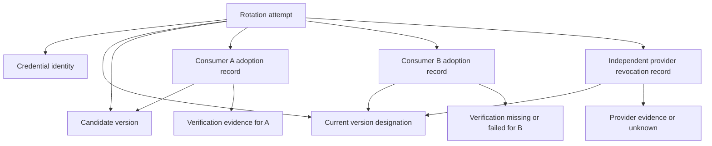

# Operational notebook: conceptual model

## Status and authority

Design proposal for a notebook for work requiring secrets. Approval covers full design-change preparation, not detailed architectural decisions or implementation acceptance. Every model element and behavior below is a **proposal**, except explicitly quoted accepted law and the stated implementation baseline.

Navigation: [Overview](README.md) · [Scenarios](scenarios.md) · [Transition](transition.md) · [Plan](../../../plans/operational-notebook.md).

**Contract baseline:** the accepted law's paste row, quoted in the [transition record](transition.md#copy-and-reuse), specifies cloning on paste after copy. Shared credential identity is a new proposal, not an implication of that transport. This document does not establish migration compatibility or persistence guarantees.

**Authoritative boundary:** accepted [Law 0001, lines 69–125](../../../law/0001-sealed-object.md) states:

> A sealed item occupies one position in the document, but its plaintext is
> not part of the document's ambient text.

The same accepted source states:

> There
> is no reveal affordance at any privilege, so no label may imply one (D-08).

**Proposal scope:** notebook organization, explicit references, context bindings, and evidence about credential use. Command execution, reveal, and shared team authentication are excluded from initial scope. External-source connection design is not an authorization architecture approval.

## Working structure versus storage structure

**Proposal:** a page organizes a task: notes, procedure, environment, credential occurrences, and recorded outcomes. A provider's vault, folder, or storage path is source information, not the required shape of the notebook. One task can reference several sources; one credential identity can appear in several tasks.

**Proposal:** local occurrence means a placement on a page, not a separate secret identity. Its label, annotation, and role in that page are local. Sharing an identity does not imply sharing page text, authentication, or every version selection.

## Proposed model vocabulary

| Proposed concept | Meaning in this proposal |
| --- | --- |
| Page | Working context containing prose, procedures, and local credential occurrences. |
| Occurrence | Page-local placement referencing a credential identity, with local annotation and an explicit role where needed. |
| Credential identity | Stable conceptual identity for the credential across occurrences and changes of value; not the plaintext or a provider path. |
| Source note | Optional description of where a manually supplied value originated; not a connection or retrieval configuration. |
| Version | A particular locally managed value, with optional provenance and available evidence; distinct from the credential identity. |
| Retrieval state (future) | Outcome of an automated external access attempt; deferred with connectors, not a state required for manual input. |
| Procedure | Reusable description of work and required credential roles, not executable automation. |
| Environment | Explicit context such as a synthetic staging or production target. |
| Role binding | Association of a procedure role and environment with a credential identity; version-selection policy remains open. |
| Consumer record | Documented use by a service or workflow, with independently recorded version adoption evidence. |

### Initial scope: manual values and optional provenance (ON-R01)

All values in the initial design are manually typed or pasted by the person and managed locally. An optional source note can describe an origin such as a password-manager item, vendor console, or terminal application. Typing versus pasting does not establish whether the value was newly created or copied from an up-to-date source; no acquisition taxonomy is required to enter a value.

**Imported copy** means a locally stored version obtained from another source. Import describes provenance, not a fourth source mode or a live connection. The resulting value is locally managed; an external origin description does not change that relationship. Import or paste time alone supplies no evidence of continued freshness at the origin.

A manual locator can be ordinary page text or a link directing the person elsewhere. It does not require a separate credential source object. Provenance associated with a version describes that value's origin; it need not apply to later replacements of the same credential.

### Proposed paste-time source suggestions

Offer best-effort suggestions from metadata accompanying an explicit paste, initially targeting password managers, browsers, and terminal applications. This is input assistance, not a connector, background clipboard monitor, or application-activity tracker.

- The person can accept, edit, or ignore a suggestion, or enter a source note manually. Missing metadata does not prevent paste or require a source note.
- An application identifier, a webpage origin, and a sensitive-content marker mean different things. A generic sensitive-content marker supplies no application name.
- Present inferred or application-reported source information as a suggestion, not verified provenance. Do not infer the issuer, environment, account, or freshness from the copying application.
- For browser URLs, propose a hostname-only suggestion by default rather than automatically retaining the full URL. Paths and queries may contain sensitive information.
- A terminal application hint does not establish a command, remote host, shell session, or upstream secret store. Do not inspect terminal history or sessions to fill gaps.
- Metadata parsing limits, source-note storage/export, and attribution of user confirmation need review before implementation. No supported-app coverage is promised by this design.

See [Clipboard provenance: facts and assumptions](clipboard-provenance.md) for evidence, limitations, and synthetic validation cases.

### Future external connections

If automated retrieval is introduced later, distinguish the credential's source relationship (locally managed, connected external, or a formal manual locator if justified) from a particular version's acquisition provenance. Retrieving through a connection would not itself convert a credential to local management; importing an independent copy would. Retrieval, caching, retained snapshots, offline behavior, and freshness evidence remain ON-D03/04 questions, not prerequisites for manual input.

## Proposed model diagram

Arrows below document conceptual references, not runtime discovery, execution, or a storage schema. Cardinality and ownership implementation are not settled by this diagram.

## Proposed progressive introduction

1. **Proposal:** start with a page and an occurrence while describing actual work; a registry setup step is not required.
2. **Proposal:** offer explicit reuse of an existing identity when another page needs the same credential. Ordinary native copy is not silently reinterpreted as reuse.
3. **Proposal:** introduce a procedure role when repeated work benefits from naming that dependency.
4. **Proposal:** introduce explicit environment bindings when the procedure has multiple contexts. Missing bindings remain visibly unresolved rather than selecting a credential by proximity or label similarity.
5. **Proposal:** derive a reference view from documented occurrences, bindings, and consumer records. It is not a discovered inventory of running infrastructure or proof that all consumers are known.

## Proposed rotation model

**Proposal:** a rotation attempt relates an identity, the version designated current, and a candidate version. Current is a notebook designation, not evidence of universal deployment. Multiple consumers can report different adoption states during one attempt.

**Proposal:** consumer adoption, verification evidence, and provider revocation are independent records. An unavailable consumer can remain unresolved after another consumer adopts the candidate. Provider revocation is not inferred from candidate creation or a page edit.

This proposed diagram is a set of relationships, not a linear global state machine. It does not authorize provider operations. Promotion, abandonment, concurrent attempts, and completion criteria require decisions.

## Decision gates and proposed acceptance targets

- **Acceptance target:** two pages can show separate annotations while visibly referencing one proposed identity; native clone behavior remains distinguishable.
- **Acceptance target:** environment, binding, selected version, optional source note, and separately recorded evidence are distinguishable; source configuration is not required for manual input.
- **Acceptance target:** paste-time source suggestions are optional and best-effort, including absent or ambiguous metadata; they do not change local management or imply freshness.
- **Acceptance target:** a partial rotation can show different consumer outcomes and unknown provider revocation simultaneously.
- **Decision gate — lifecycle:** removing an occurrence, expiring a page, destroying a version, and deleting an identity need distinct policy decisions before shared-identity behavior is accepted. Existing law is not overridden by this proposal.
- **Decision gate — transfer:** copy, cross-notebook transfer, and export need explicit clone/reference/snapshot semantics and recipient behavior; no new portability or plaintext handling guarantee is established here.
- **Decision gate — retrieval:** connector authorization, caching, offline access, and evidence validity need approval; no fallback is assumed.
- **Decision gate — rotation:** who designates current, what verifies each consumer, and what evidence establishes provider revocation or attempt completion remain unresolved.
- **Decision gate — architecture:** identity representation, storage, synchronization, migration, and version retention require separate decisions.
