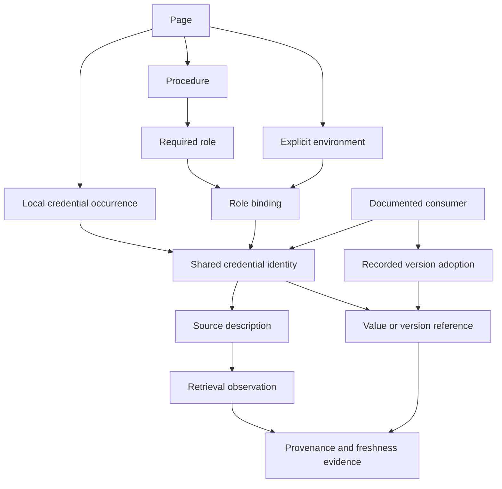
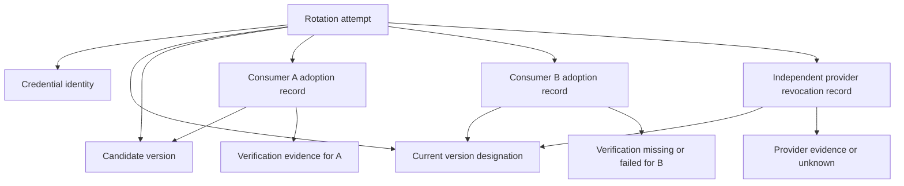

# Operational notebook: conceptual model

## Status and authority

Design proposal for a notebook for work requiring secrets. Approval covers full design-change preparation, not detailed architectural decisions or implementation acceptance. Every model element and behavior below is a **proposal**, except explicitly quoted accepted law and the stated implementation baseline.

Navigation: [Overview](README.md) · [Scenarios](scenarios.md) · [Transition](transition.md) · [Plan](../../../plans/operational-notebook.md).

**Contract baseline:** the accepted law's paste row, quoted in the [transition record](transition.md#copy-and-reuse), specifies cloning on paste after copy. Shared credential identity is a new proposal, not an implication of that transport. This document does not establish migration compatibility or persistence guarantees.

**Authoritative boundary:** accepted [Law 0001, lines 69–125](../../../law/0001-sealed-object.md) states:

> A sealed item occupies one position in the document, but its plaintext is
> not part of the document's ambient text.

The same accepted source states:

> There
> is no reveal affordance at any privilege, so no label may imply one (D-08).

**Proposal scope:** notebook organization, explicit references, context bindings, and evidence about credential use. Command execution, reveal, and shared team authentication are excluded from initial scope. External-source connection design is not an authorization architecture approval.

## Working structure versus storage structure

**Proposal:** a page organizes a task: notes, procedure, environment, credential occurrences, and recorded outcomes. A provider's vault, folder, or storage path is source information, not the required shape of the notebook. One task can reference several sources; one credential identity can appear in several tasks.

**Proposal:** local occurrence means a placement on a page, not a separate secret identity. Its label, annotation, and role in that page are local. Sharing an identity does not imply sharing page text, authentication, or every version selection.

## Proposed model vocabulary

| Proposed concept | Meaning in this proposal |
| --- | --- |
| Page | Working context containing prose, procedures, and local credential occurrences. |
| Occurrence | Page-local placement referencing a credential identity, with local annotation and an explicit role where needed. |
| Credential identity | Stable conceptual identity for the credential across occurrences and changes of value; not the plaintext or a provider path. |
| Source | Where a value is managed or located, and how access is described. Source changes are distinct from identity changes. |
| Version | A particular value or version reference, with provenance and available evidence; distinct from the identity and retrieval outcome. |
| Retrieval state | Outcome of an access attempt, such as unavailable or retrieved, with observation time; not proof of validity or freshness. |
| Procedure | Reusable description of work and required credential roles, not executable automation. |
| Environment | Explicit context such as a synthetic staging or production target. |
| Role binding | Association of a procedure role and environment with a credential identity; version-selection policy remains open. |
| Consumer record | Documented use by a service or workflow, with independently recorded version adoption evidence. |

### Proposed source modes

- **Local managed:** the notebook manages a local value; lifecycle policy for shared identities remains decision-gated.
- **Connected external:** a source connection can retrieve from an external authority. Successful retrieval is not evidence that every consumer uses that value.
- **Manual locator:** a descriptive location directs a person to an external source without automated retrieval. A locator is not a value or a successful access result.

**Proposal:** an imported value is a copy. Its freshness is unknown unless evidence supports a narrower statement, with provenance and observation time. Neither import time nor a successful retrieval alone establishes continued freshness. Evidence expiry and source-specific verification remain open decisions.

## Proposed model diagram

Arrows below document conceptual references, not runtime discovery, execution, or a storage schema. Cardinality and ownership implementation are not settled by this diagram.

## Proposed progressive introduction

1. **Proposal:** start with a page and an occurrence while describing actual work; a registry setup step is not required.
2. **Proposal:** offer explicit reuse of an existing identity when another page needs the same credential. Ordinary native copy is not silently reinterpreted as reuse.
3. **Proposal:** introduce a procedure role when repeated work benefits from naming that dependency.
4. **Proposal:** introduce explicit environment bindings when the procedure has multiple contexts. Missing bindings remain visibly unresolved rather than selecting a credential by proximity or label similarity.
5. **Proposal:** derive a reference view from documented occurrences, bindings, and consumer records. It is not a discovered inventory of running infrastructure or proof that all consumers are known.

## Proposed rotation model

**Proposal:** a rotation attempt relates an identity, the version designated current, and a candidate version. Current is a notebook designation, not evidence of universal deployment. Multiple consumers can report different adoption states during one attempt.

**Proposal:** consumer adoption, verification evidence, and provider revocation are independent records. An unavailable consumer can remain unresolved after another consumer adopts the candidate. Provider revocation is not inferred from candidate creation or a page edit.

This proposed diagram is a set of relationships, not a linear global state machine. It does not authorize provider operations. Promotion, abandonment, concurrent attempts, and completion criteria require decisions.

## Decision gates and proposed acceptance targets

- **Acceptance target:** two pages can show separate annotations while visibly referencing one proposed identity; native clone behavior remains distinguishable.
- **Acceptance target:** environment, binding, source mode, selected version, and retrieval evidence are inspectable without treating them as interchangeable states.
- **Acceptance target:** a partial rotation can show different consumer outcomes and unknown provider revocation simultaneously.
- **Decision gate — lifecycle:** removing an occurrence, expiring a page, destroying a version, and deleting an identity need distinct policy decisions before shared-identity behavior is accepted. Existing law is not overridden by this proposal.
- **Decision gate — transfer:** copy, cross-notebook transfer, and export need explicit clone/reference/snapshot semantics and recipient behavior; no new portability or plaintext handling guarantee is established here.
- **Decision gate — retrieval:** connector authorization, caching, offline access, and evidence validity need approval; no fallback is assumed.
- **Decision gate — rotation:** who designates current, what verifies each consumer, and what evidence establishes provider revocation or attempt completion remain unresolved.
- **Decision gate — architecture:** identity representation, storage, synchronization, migration, and version retention require separate decisions.
